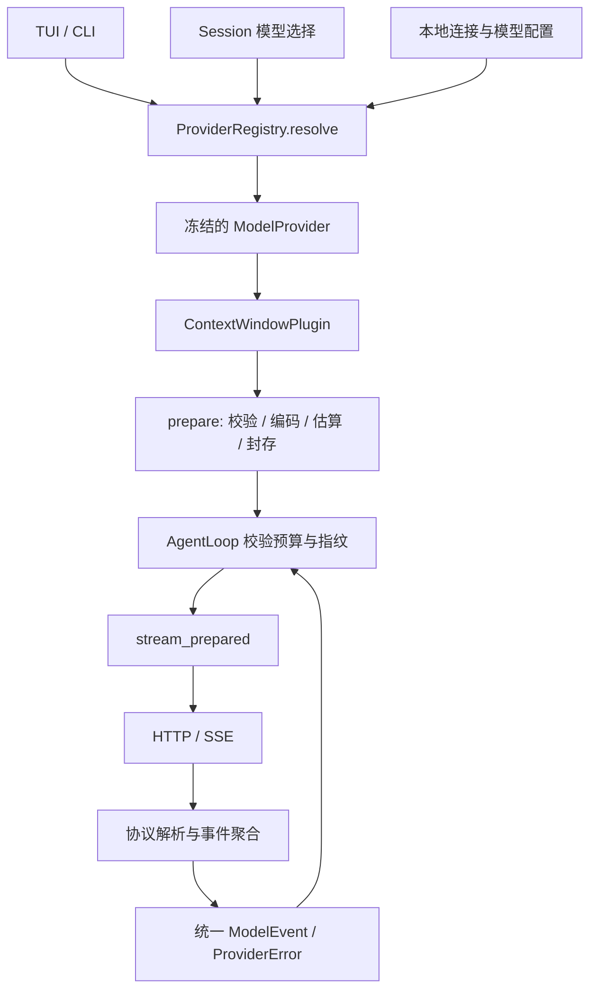

# 模型供应商模块设计

状态：设计提案，尚未实现。2026-11-07。

## 1. 目标与当前边界

供应商模块向 Agent Loop 和上下文管理提供稳定的模型调用接口，统一配置解析、请求编译、流式事件、能力、用量和错误；协议差异由模块内部的适配器处理。

当前已有基础：

- [ModelProvider](../../src/agent/provider.rs) 提供 capabilities、prepare、stream_prepared 和标准 ModelEvent。
- [ContextWindowPlugin](../../src/context/plugin.rs) 在最终请求编译后校验预算，依赖不可变 PreparedRequest。
- [HttpProvider](../../src/agent/http_provider.rs) 编码 Chat Completions 和 Anthropic Messages，但读取完整 JSON 后才产生事件，没有真正增量读取网络响应。
- [Application](../../src/tui/service.rs) 直接选择协议、创建客户端并配置缓存；[session/profile](../../src/session/profile.rs) 仅解析 endpoint/key。
- [SessionModel](../../src/session/types.rs) 将本地连接引用、模型和协议格式同时保存在会话中，新增协议需要修改会话校验。
- Loop 在 Complete 后停止消费流；完成之后到达的 Usage 无法被处理。模型结束原因尚未独立于 Agent 的停止原因表达。

本次首先统一生成模型的文本与函数工具调用。检索使用的 Embedder、Reranker 保留独立接口，将来可以复用凭据与 HTTP 基础设施。首版不加入自动跨供应商故障转移、云厂商签名协议、音视频或供应商原生工具执行。

## 2. 区分连接、协议和模型

| 概念 | 内容 | 示例 |
| --- | --- | --- |
| ProviderConnection | 一条连接的端点、认证引用、超时、协议与连接选项 | company-gateway、local-server |
| ProtocolAdapter | 请求编码和响应解析规则 | openai_chat、openai_responses、anthropic_messages |
| ModelDefinition | 模型别名、实际模型 ID、能力和默认生成参数 | research → 某连接上的模型 ID |
| ResolvedModel | 一次 run 冻结的连接、模型与有效能力 | 本轮固定使用的解析结果 |

同一供应商可以暴露多种协议；多家供应商也可以共用一种兼容协议。不要通过模型名或 URL 猜协议。兼容网关的差异使用有类型的配置项表达，例如输出 token 参数名、是否支持流式用量；避免按供应商品牌复制整套适配器。

## 3. 调用链与职责



- Registry 负责加载配置、查找模型、解析凭据引用、创建并复用客户端，返回已经绑定模型的 Provider。
- 现有 ModelProvider 继续作为 Loop 与 Context 的依赖，首轮不增加独立 RequestCompiler trait。
- 适配器负责协议编码、能力约束、流解析和 usage 映射；不负责检索、Skill、上下文裁剪或工具执行。
- Transport 共享连接池、HTTP 状态处理、超时、取消和 SSE 分帧；协议层自行解释 event/data。
- SessionRunner 在调用之前冻结解析结果，在 segment header 中保存可重放的非敏感配置摘要；业务层不构造供应商客户端。

Registry 使用 Rust 工厂注册内置适配器，首版不引入动态库或运行时插件 ABI。已有 Agent Loop 插件仍按原方式工作。

## 4. 统一接口

以下是目标接口示意，实际迁移保留旧路径的兼容导出：

```rust
pub struct ModelSelection {
    pub model_ref: String,
    pub overrides: GenerationOptions,
}

impl ProviderRegistry {
    pub async fn resolve(
        &self,
        selection: &ModelSelection,
        cancel: CancellationToken,
    ) -> Result<Arc<dyn ModelProvider>, ProviderError>;
}

#[async_trait]
pub trait ModelProvider: Send + Sync {
    fn descriptor(&self) -> &ResolvedModelDescriptor;
    fn capabilities(&self) -> &ModelCapabilities;
    fn prepare(&self, request: ModelRequest)
        -> Result<PreparedRequest, ProviderError>;
    async fn stream_prepared(
        &self,
        request: PreparedRequest,
        cancel: CancellationToken,
    ) -> Result<ModelEventStream, ProviderError>;
}

pub type ModelEventStream = Pin<Box<
    dyn Stream<Item = Result<ModelEvent, ProviderError>> + Send
>>;
```

外部只操作消息、工具、生成参数和能力。endpoint、认证头、协议字段留在供应商模块。现有 stream(ModelRequest) 可保留为 prepare + stream_prepared 的便捷包装；上下文协调路径继续强制使用封存请求。

### 4.1 请求封存

PreparedRequest 保存最终编码的 body bytes、语义配置指纹、估算报告和已有的原始消息/工具映射。stream_prepared 发送同一份 body bytes，禁止重新编排消息、追加缓存字段或调整 token 参数。

语义指纹覆盖协议及其版本、端点路由、实际模型 ID、影响编码的能力、生成参数、缓存策略和非敏感的认证作用域标识。认证密钥不进入 body、指纹、Debug、日志或会话记录。凭据轮换可以更新认证材料，但不能借此改变本轮模型与请求语义。

一个 run 内禁止配置热更新改变已有 Provider。下一 run 重新解析配置；每次实际解析结果都记录非敏感摘要，使别名改指向后仍能诊断历史调用。

### 4.2 能力

能力至少包含 context_tokens、max_output_tokens、streaming、tools、tool_choice、structured_output、reasoning、缓存模式及 token 计数方式。能力以模型和连接的交集为准，兼容网关可以进一步限制。

未识别的自定义模型必须显式配置容量；不继续假定所有模型都是 128K。有效窗口取用户设置与已知模型限制的较小值；输出预算同理。遇到用户明确要求但连接不支持的功能，返回 UnsupportedFeature，不静默丢弃参数。

首版保持文本/函数调用内容结构，不发送 reasoning 请求。后续支持 reasoning 或原生状态前，需要将 Assistant 内容升级为有序 blocks，并为需要回传的供应商不透明项保存协议命名空间、版本及兼容标识；旧消息向后兼容读取，旧 JSONL 和 checkpoint hash 不改写。不能把签名或不透明状态塞进可跨模型发送的普通文本，也不能无提示丢失继续推理必需的状态。

## 5. 流式事件与完成语义

统一事件建议包括 Started、TextDelta、ToolCallStarted、ToolArgumentsDelta 和 Completed。错误使用 Stream 的 Result；请求建立失败和流中失败共用 ProviderError，不再额外发一份字符串 Error 事件。

Completed 携带完整 AssistantMessage、模型结束原因、最终 Usage 和供应商 request_id，是流的最后一个业务事件。Loop 和摘要服务都从它读取最终用量，避免在 Complete 后提前退出造成漏计。若保留实时用量，必须标明它是 snapshot，最终值采用替换语义，禁止每次累加。

模型结束原因与 Agent StopReason 分开：至少区分正常结束、请求工具、输出达到上限、拒绝和其他原因。输出上限导致的工具参数截断不得进入工具执行；完整的已生成文本可以作为带结束状态的消息保存，不能显示为正常完成。

SSE 与聚合器必须处理：

1. 网络 chunk 不等于 SSE event，也不保证 UTF-8、JSON 或工具参数在 chunk 边界完整。
2. 多行 data、CRLF、注释/心跳、空行分隔、多个 event 合并到一次读取，以及带上限的缓冲区。
3. 工具按协议的 index/item_id 聚合，最终校验 call_id 唯一、name 与 JSON 参数完整。参数 delta 只用于显示，工具只在完整消息提交后执行。
4. EOF 不是成功信号，必须满足协议对应的终止条件。缺少完成状态、截断或非法参数返回明确错误，已经展示的增量不能被当作已提交消息。
5. 取消覆盖连接建立、读取、等待重试和解析过程；首字节超时、流空闲超时和整体 deadline 分别处理，心跳不能无限延长整体 deadline。

OpenAI 的 Chat Completions 使用 delta chunk，Responses 使用有类型的语义事件，因此需要两个独立适配器，不能只改 endpoint 后共用解析器。工具参数也有增量生命周期。依据：[Streaming API responses](https://developers.openai.com/api/docs/guides/streaming-responses)、[Function calling](https://developers.openai.com/api/docs/guides/function-calling)。

## 6. 用量、估算与缓存

统一用量约定：

- input_tokens 表示总输入，cached_input_tokens 与 cache_write_input_tokens 是输入中的分类，不能再次相加。
- output_tokens 表示总输出；reasoning_output_tokens 若可得，是输出中的分类。
- 未报告的值为 None；零和未知分开。协议解析器依据相应协议的计量定义归一化，保留非敏感原始 usage 供诊断。
- 估算报告标明方式（模型 tokenizer、供应商 count 接口、保守估算）和是否精确。首版允许继续使用当前保守字节估算，并在观测中说明误差；不将它标为真实 token 数。

Context 负责稳定前缀、区域顺序与压缩，Provider 负责缓存字段编码和能力约束。逻辑请求可携带缓存意图/候选边界；适配器在 prepare 中生成供应商支持的参数，并将其纳入最终预算和指纹。

缓存策略包含 disabled、provider_default、explicit_prefix；支持情况由能力决定。上下文压缩、切换模型或改变协议可能使缓存失效，不能为命中缓存跨越权限、混用不同连接的供应商状态，或对自定义端点承诺一定命中。记录实际 cached/write usage 评价效果。

## 7. 配置与会话衔接

新增版本化的本机配置 `.lumen/providers.yaml`，在工作区和 standalone 根目录下使用同样格式。该文件与现有本地配置一样不作为会话历史同步。凭据初版支持 env 和显式 none；可对接项目已有 keyring 基础设施。

```yaml
schema_version: 1
default_model: research
providers:
  company:
    protocol: openai_chat
    base_url: https://gateway.example/v1
    auth:
      kind: env
      variable: COMPANY_MODEL_KEY
    timeout:
      connect_ms: 10000
      first_byte_ms: 60000
      idle_ms: 30000
    options:
      stream_usage: true
models:
  research:
    provider: company
    model: actual-model-id
    capabilities:
      context_tokens: 64000
      max_output_tokens: 4096
      tools: true
    defaults:
      cache: provider_default
```

上述容量只是配置示例，不表示任何实际模型的规格。endpoint 路径由适配器根据 base_url 生成；旧配置中的完整 endpoint 使用独立 legacy_endpoint 字段兼容，禁止再追加一次路径。URL 的查询凭据和认证头需单独处理，避免进入配置摘要或异常日志。

新会话保存 model_ref、用户覆盖参数，以及可供展示的最近解析摘要。模型容量来源于解析后的能力；会话中既有 context 设置继续作为用户上限，不成为模型能力的权威来源。

兼容策略：

1. 新配置显式存在时，按 model_ref 精确解析；配置错误必须报错，不能落回演示模型。
2. 没有新配置时，将现有 `.lumen/model-profiles.yaml`、SessionModel 的 model/format 与 `LUMEN_MODEL_*` 转为内存中的 legacy 连接，不改写旧文件。
3. `openai` 旧格式明确映射 openai_chat，`anthropic` 映射 anthropic_messages；不将旧会话自动改成 Responses。
4. Session metadata 使用版本化读取和显式写入迁移，解除校验中的两个 format 硬编码。新 run 记录解析摘要，旧 segment 与 context 原始记录不变。
5. 即使连接不存在或密钥未配置，历史仍可读取；发送前失败。mock 必须显式选中，保留测试注入，不作为真实连接失败的兜底。

TUI/CLI 的发送入口缩减为：读取会话选择 → Registry.resolve → 根据实际能力构造 ContextConfig → 注入 Provider 到 ContextWindowPlugin 和 AgentLoop → SessionRunner.run。`/model` 选择别名，可增加 `/models` 和 `/providers` 展示可用配置；界面不显示密钥。

## 8. 统一错误、重试与观测

ProviderError 至少区分 Configuration、Authentication、Permission、RateLimited、ContextExceeded、UnsupportedFeature、InvalidRequest、Transport、Protocol、Cancelled、Timeout 和 Upstream。附带可选的 HTTP status、provider code、request_id、retry_after、请求接受状态和脱敏诊断。

重试遵循交付状态：

- 认证、参数、容量、协议错误不自动重试。
- 明确未接受的临时错误可有限退避，并遵守 Retry-After、整体 deadline 与取消。
- 网络中断无法确认服务端是否接受、已经收到流式业务事件或已经向用户交付内容时，首版返回错误，不自动再次生成。
- 不在后台切换供应商，不自动重放工具调用。后续引入有供应商保证的幂等请求能力时，单独定义恢复规则。

记录模型/连接引用、协议、请求 ID、配置指纹、估算与实际用量、首个内容延迟、总耗时、错误类型、重试次数和缓存命中数据。默认不记录正文、工具参数、认证头及完整错误响应体。

## 9. 文件组织与实现顺序

```text
src/provider/
  mod.rs / registry.rs       模型解析、工厂注册和客户端复用
  config.rs / credentials.rs 本机配置、旧配置转换和凭据引用
  capabilities.rs            模型能力与生成参数校验
  error.rs / usage.rs         统一错误与用量语义
  transport.rs / sse.rs       HTTP、取消、超时与 SSE 分帧
  openai_chat.rs             Chat Completions 编解码与聚合
  openai_responses.rs        Responses 编解码与聚合
  anthropic_messages.rs     Messages 编解码与聚合
  mock.rs                   显式演示与测试模型

src/agent/provider.rs        保留公共契约；旧 HttpProvider 路径兼容导出
src/session/profile.rs       legacy 配置转换的兼容入口
```

| 阶段 | 交付 | 验收 |
| --- | --- | --- |
| P0 配置与边界 | Registry、连接/模型分离、能力、统一错误、legacy 转换 | TUI 不构造协议客户端；旧配置与会话仍可用；真实连接失败不落回 mock |
| P1 流式基础 | Transport、SSE、Chat 与 Messages 适配器、最终结果语义 | 真正增量展示；工具完整后执行；取消有效；最终用量不漏计 |
| P2 多协议 | Responses 适配器、协议独立的模型选择与配置摘要 | 同一 Loop 通过三个协议的一致性测试；切换能力重新校验预算 |
| P3 观测与策略 | 缓存意图、计数质量报告、有限重试、诊断命令 | 缓存参数在 prepare 前确定；重试无重复显示或工具执行；日志脱敏 |

首版建议完成 P0–P2；P3 保留必要的超时、基础用量和脱敏，进一步缓存调优与重试策略按实际连接需求展开。

## 10. 关键测试

使用本地 HTTP stub 与固定协议样本，不依赖真实密钥或计费 API：

1. 多协议共同完成文本 → 多个工具 → 工具结果 → 文本，原 Loop/Context/Session 测试保持通过。
2. 对 UTF-8、多行 data、工具 JSON 和终止事件逐字节切分；同一结果在不同 chunk 边界下保持一致。
3. 并行工具参数交错、重复 call_id、无效 JSON、输出上限、拒绝、终止前断流分别校验。
4. 请求建立前取消、流中取消、首字节/空闲/整体超时与明确限流；取消后不再产出事件或执行工具。
5. Complete 最后出现，最终用量只有一次，缓存/推理分类不重复计费；缺失 usage 保持未知。
6. prepare 的实际 body bytes 与发送内容一致，别名/模型/协议不匹配的 PreparedRequest 被拒绝；发送阶段不改变预算。
7. 新配置、旧 profile/env、显式 mock、本地无认证连接、未知模型容量及缺失密钥均有确定行为。
8. 会话重启、旧格式读取、新 metadata 迁移及 provider 切换不修改旧 JSONL/checkpoint，不将不兼容的原生状态跨协议发送。
9. 日志、错误、指纹、配置摘要和会话存储中均不包含测试密钥。
