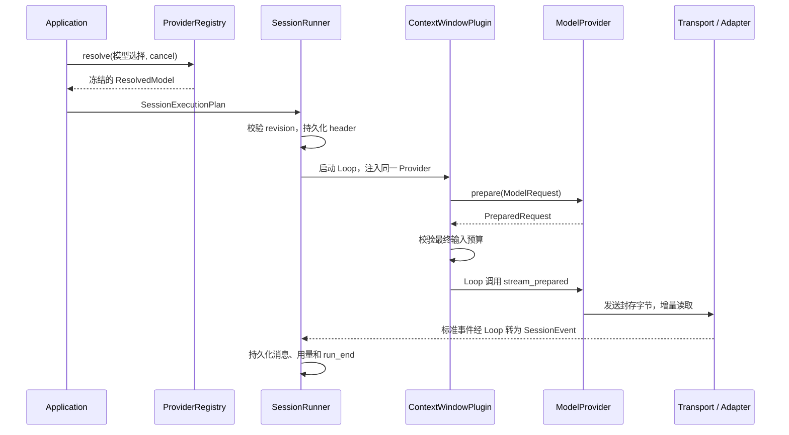

# 模型供应商模块实施方案

状态：首版已实现，2026-11-07。本文固定首版范围、接口、兼容规则和验收标准；实际接口细化与验证范围见第 14 节。

## 1. 目标与首版范围

建立 `src/provider/` 模块，统一生成模型的配置、能力、请求、流式响应、工具调用、缓存参数、用量和错误。Agent Loop、Context 和 Session 依赖同一套模型接口。

| 内容 | 首版交付 |
| --- | --- |
| 协议 | `openai_chat`、`openai_responses`、`anthropic_messages`，每种协议独立适配器 |
| 消息 | 文本、函数工具调用与工具结果；支持多工具参数增量交错 |
| 传输 | 真正的 HTTP 流式读取；显式配置的非流式 JSON 兼容模式 |
| 配置 | 本机 providers.yaml，连接与模型别名分离，兼容旧 profile/env |
| 认证 | env 引用、显式 none；run 开始前解析并冻结 |
| 会话 | 实际模型与能力摘要、结束原因、用量、继续调用所需的原生状态 |
| 可靠性 | 取消、分阶段超时、限长解析、结构化错误；零自动重试 |
| 缓存 | 统一缓存意图、能力检查、真实缓存用量；显式区域断点后续扩展 |
| 管理 | `/model <alias>`、`/models`、`/providers` |

首版排除动态库插件、自动模型发现、自动跨供应商故障转移、价格结算、云厂商签名协议、音视频、供应商托管工具、用户可调 reasoning 参数、原生压缩和服务端会话链。Embedder、Reranker 保留现有独立接口。

兼容供应商通过显式选择协议和能力接入；自称兼容的端点仍需满足对应适配器的协议测试。

## 2. 当前代码与改造点

| 位置 | 当前行为 | 改造 |
| --- | --- | --- |
| [agent/provider.rs](../../src/agent/provider.rs) | 已有 ModelProvider、PreparedRequest；能力只有容量字段 | 保留业务依赖入口，升级能力、事件、错误和封存内容 |
| [agent/http_provider.rs](../../src/agent/http_provider.rs) | 一个类型匹配两种协议，读取完整 JSON 后包装成流 | 拆为协议适配器和共享 Transport，旧类型保留兼容构造入口 |
| [agent/loop_runner.rs](../../src/agent/loop_runner.rs) | Complete 后停止消费，只得到 AssistantMessage | 消费完整最终结果，根据模型结束原因决定是否执行工具 |
| [context/plugin.rs](../../src/context/plugin.rs) | prepare 后检查窗口，依赖 configuration_key | 使用有效能力与稳定配置指纹，保留最终预算检查 |
| [context/compaction.rs](../../src/context/compaction.rs) | 摘要复用 Provider，单独收集 Usage | 采用相同最终结果约定，摘要用量继续单独记账 |
| [session/profile.rs](../../src/session/profile.rs) | 解析 endpoint/key 元组 | 变为旧配置兼容入口，正常解析交给 Registry |
| [session/runner.rs](../../src/session/runner.rs) | header 保存会话配置 | 接收冻结的执行计划，保存实际解析结果 |
| [tui/service.rs](../../src/tui/service.rs) | 匹配 format、构造客户端、读取缓存 env | 只调用 Registry，删除供应商协议分支 |

## 3. 固定设计决策

| 编号 | 决定 | 原因 |
| --- | --- | --- |
| D1 | 连接、协议、模型分别建模 | 一个供应商可以有多种协议，多家供应商可以复用协议 |
| D2 | 业务只依赖一个 ModelProvider trait | 复用 Loop/Context 注入方式，避免编译与发送配置漂移 |
| D3 | 内部静态注册协议工厂 | 新增连接只需配置；新增协议增加适配器 |
| D4 | 模型、配置、凭据在 run 开始前冻结 | 同一 run 的对话、工具续轮和摘要使用一致连接 |
| D5 | prepare 封存实际 body bytes | 预算检查与发送内容一致，发送时不再改消息或缓存字段 |
| D6 | Completed 为最后事件，包含最终用量 | 避免 Loop 提前停止造成漏计，避免增量用量重复累计 |
| D7 | 原生回放状态跟随所属 Assistant 原子保存 | 保住协议顺序和工具续轮所需的信息 |
| D8 | Session 保存模型选择，本机保存连接 | 会话可以同步，设备可以采用自己的连接和凭据 |
| D9 | 配置失败返回错误，mock 显式选择 | 真实模型请求不会意外变成演示结果 |
| D10 | 零自动重试，无隐式供应商切换 | 确保首版交付语义明确，避免重复生成与工具副作用 |

## 4. 概念、模块与职责

| 类型 | 保存的内容 | 生命周期 |
| --- | --- | --- |
| ProviderConnection | 协议、端点、认证引用、传输设置、协议选项 | 本机配置 |
| ModelDefinition | 模型别名、连接引用、实际模型 ID、能力、默认生成参数 | 本机配置 |
| ModelSelection | 会话选择的别名与覆盖项，或旧 profile/model/format | Session metadata |
| ResolvedModel | 已解析的非敏感 descriptor 与绑定的 Provider | 一个 run |
| PreparedRequest | 完整编码字节、语义指纹、估算与标准请求 | 一次模型请求 |

协议不能由模型名、供应商品牌或 URL 猜测。兼容网关差异使用有类型的选项表达，例如输出 token 参数名、流式用量支持，不按品牌复制整套适配器。

```text
src/provider/
  mod.rs                  对外导出
  registry.rs             模型解析、工厂注册、客户端池
  config.rs               配置 schema、默认值、校验
  catalog.rs / catalog.json 数据驱动的供应商预设、可用模型合并
  management.rs           本机认证管理、显式模型发现与缓存
  legacy.rs               旧 profile/env/SessionModel 转换
  credentials.rs          env/local/none、secret 脱敏
  capabilities.rs         能力、参数与容量约束
  error.rs / usage.rs     统一错误和用量语义
  transport.rs / sse.rs   HTTP、取消、超时、SSE 分帧
  replay.rs               原生状态封装与兼容性校验
  protocols/
    mod.rs                内部适配器契约和工厂
    openai_chat.rs
    openai_responses.rs
    anthropic_messages.rs
  mock.rs                 测试模型与显式演示模型

src/agent/provider.rs      业务公共契约
src/agent/http_provider.rs 旧构造入口的兼容包装
src/session/profile.rs    旧配置 API 兼容入口
```

公共模型契约暂留 agent/provider.rs。provider 的实现引用 AgentMessage 与该契约，公共契约引用 provider 的能力、错误等数据类型；这些位于同一 crate，不拆 crate，也不把协议实现引入 Loop。

内部 ProtocolAdapter 提供 encode、创建响应 decoder、协议能力约束与回放转换。共享 HttpModelProvider 实现业务 trait，持有 adapter、ResolvedModel 和 Transport。Transport 只负责网络与 SSE 分帧，decoder 负责供应商事件语义。Registry 负责配置和工厂装配；上述模块都不负责检索、Skill、上下文裁剪或执行工具。

内部契约固定为：

```rust
trait ProtocolAdapter: Send + Sync {
    fn encode(&self, model: &ResolvedModelDescriptor, request: &ModelRequest)
        -> Result<EncodedRequest, ProviderError>;
    fn decoder(&self, model: &ResolvedModelDescriptor)
        -> Box<dyn ResponseDecoder>;
    fn decode_json(&self, model: &ResolvedModelDescriptor, body: &[u8])
        -> Result<ModelResponse, ProviderError>;
}

trait ResponseDecoder: Send {
    fn push(&mut self, event: SseEvent)
        -> Result<Vec<ModelEvent>, ProviderError>;
    fn finish(&mut self) -> Result<(), ProviderError>;
}
```

EncodedRequest 只含 body、语义头和计数所需信息；路由与认证由绑定 Provider 管理。finish 校验是否已满足协议终止条件，不用 EOF 补造成功。三个适配器共同通过标准事件行为测试，各自保留 wire-format 固定样本测试。



## 5. 配置 schema 与确定的解析规则

### 5.1 文件和示例

路径固定为当前 store 根目录下 `.lumen/providers.yaml`，workspace 和 standalone 相同；沿用 `.lumen/` 的本机数据语义，不进入 Git 和会话历史同步。首版不叠加全局配置，不隐式跨目录查找。

```yaml
schema_version: 1
default_model: research
providers:
  company:
    protocol: openai_chat
    base_url: https://gateway.example/v1
    state_scope: company-primary-account
    auth:
      kind: env
      variable: COMPANY_MODEL_KEY
    transport:
      mode: sse
      connect_timeout_ms: 10000
      first_byte_timeout_ms: 60000
      idle_timeout_ms: 30000
      request_timeout_ms: 120000
    protocol_options:
      output_token_field: max_completion_tokens
      stream_usage: true
models:
  research:
    provider: company
    model_id: actual-model-id
    capabilities:
      context_tokens: 64000
      max_output_tokens: 4096
      tools: true
      tool_choice: [auto, none, required, named]
    defaults:
      max_output_tokens: 4096
      cache: provider_default
```

上述容量只是配置示例。真实模型的协议、model_id、容量和 auth 必须显式配置，不按模型名猜规格。供应商预设只填入连接信息；模型发现由 `/model` 中的刷新选项或 `/models <供应商>` 显式触发 GET，不发送聊天请求。接口未返回容量时必须手工补充，发现结果按连接缓存。另两个协议使用对应的 typed protocol_options，未知字段、未知版本、重复键都报配置错误。

state_scope 是本机声明的非敏感账号/项目作用域，真实连接必填；同一账号轮换密钥保持不变，改用另一个账号或项目时必须更换，用于原生状态兼容判断，不作为认证依据。

base_url 保留服务前缀（例如 /v1），适配器仅追加 chat/completions、responses 或 messages，不用 URL join 的绝对路径覆盖已有前缀。新配置拒绝 userinfo、fragment 和 query，特殊鉴权通过独立类型扩展。旧完整 endpoint 转成内部 Endpoint::Exact，不追加路径；错误和日志不打印完整旧 URL。

### 5.2 默认值

| 项 | 默认值与约束 |
| --- | --- |
| default_model | 有模型时必填且引用有效；供应商已添加但模型列表为空时允许空字符串 |
| transport.mode | sse；端点可显式选 json，不依据失败响应自动降级 |
| connect / first byte / idle / request | 10s / 60s / 30s / 120s，可配置，受 Loop 整体 deadline 约束 |
| SSE 单 event 上限 | 1 MiB，字节限长在解码之前执行 |
| 单响应累计上限 | 32 MiB，包含工具参数与回放状态；JSON 模式相同 |
| HTTP 错误体上限 | 64 KiB，仅提取脱敏结构化字段 |
| 自动重试 | 0，首版不暴露重试配置 |
| cache | provider_default；disabled 表示不申请缓存，不保证关闭服务端自动缓存 |
| temperature | 未设置不发送；显式设置需模型声明支持 |
| 可选能力 | 未声明按不支持处理，再受协议实现约束 |

结构化输出、用户可调 reasoning 参数首版不开放，显式配置返回 UnsupportedFeature。模型默认返回的必要回放项仍须按第 9 节保留，不能因未请求 reasoning 就直接丢弃。

### 5.3 解析顺序

1. Registry 绑定 store identity/root，读取并校验完整配置快照，一次 resolve 不混用不同文件版本。
2. Reference 选择精确查找新配置；缺文件、别名或凭据均失败，不回退 legacy。
3. Legacy 选择继续解析旧 profile/env；即使新配置存在，也不重解释旧会话。
4. Mock 选择使用显式演示模型。mock 为保留名称，不能被真实别名覆盖。
5. 合并参数、校验能力、计算配置指纹，解析凭据，返回冻结的 ResolvedModel。

每个 run 开始重新解析，运行中的对象不热更新。按传输设置复用 reqwest Client，认证头逐请求附加，不放入共享客户端默认头。首版关闭重定向，避免认证材料隐式发送到其他端点。

## 6. 公共数据模型和接口

以下结构为实现目标，省略 derives 和 import。

```rust
pub enum ModelSelection {
    Reference { model_ref: String, overrides: GenerationOverrides },
    Legacy { profile_ref: String, model: String, format: LegacyFormat },
    Mock,
}

pub struct ResolvedModel {
    pub descriptor: ResolvedModelDescriptor,
    pub provider: Arc<dyn ModelProvider>,
}

pub struct ResolvedModelDescriptor {
    pub model_ref: Option<String>,
    pub provider_ref: String,
    pub protocol: ProtocolKind,
    pub model_id: String,
    pub capabilities: ModelCapabilities,
    pub generation: EffectiveGenerationOptions,
    pub configuration_key: String,
}

impl ProviderRegistry {
    pub async fn resolve(
        &self,
        selection: &ModelSelection,
        cancel: CancellationToken,
    ) -> Result<ResolvedModel, ProviderError>;
}

#[async_trait]
pub trait ModelProvider: Send + Sync {
    fn descriptor(&self) -> &ResolvedModelDescriptor;
    fn capabilities(&self) -> ModelCapabilities;
    fn configuration_key(&self) -> String;
    fn supports_summary(&self) -> bool;
    fn prepare(&self, request: ModelRequest)
        -> Result<PreparedRequest, ProviderError>;
    async fn stream_prepared(
        &self,
        request: PreparedRequest,
        cancel: CancellationToken,
    ) -> Result<ModelEventStream, ProviderError>;
}
```

保留 stream(ModelRequest) 作为默认 prepare + stream_prepared 包装；上下文协调路径必须使用封存请求。mock 采用相同最终事件约定，supports_summary=false，保留旧的响应队列构造 API。

ModelCapabilities 扩展为容量、输出上限、streaming、tools、tool_choice、temperature、cache_modes、token_count_method。协议实现给出能力上限，模型配置进一步收窄；用户请求超出能力时报错，不静默丢参数。

ModelRequest 保留 messages、tools、max_output_tokens，新增可选 tool_choice 和 cache_intent。ToolChoice 定义为 Auto、None、Required、Named(String)。cache_intent 未设置时采用绑定模型默认值。纯文本调用允许空工具列表；已有工具工作流遇到 tools=false 返回 UnsupportedFeature，不在 Provider 内删除工具来伪造成功。

参数优先级：请求明确值 → 会话覆盖 → 模型 defaults。max_output_tokens 再取模型上限的较小值。ToolChoice 是单次请求属性，摘要固定 none，不继承对话的 required。结构化输出等后续能力采用显式版本扩展。

有效窗口为 min(会话窗口上限, 模型容量)，有效输出为请求/会话/模型设置与模型输出上限的最小值。Context 继续预留工具和安全空间、决定压缩；不能因模型切换绕过原有空间充足校验。

## 7. PreparedRequest、预算与缓存

### 7.1 封存内容

PreparedRequest 字段私有，只提供只读访问器：

| 内容 | 作用 |
| --- | --- |
| 标准 ModelRequest | 校验工具声明、消息来源和测试诊断 |
| body: Arc<[u8]> | 最终发送字节，含模型、stream、工具、输出限制、缓存参数 |
| semantic_headers | 影响协议的版本/功能头，不包含认证材料 |
| TokenEstimate | 估算值、方法、exact 标记 |
| configuration_key | 稳定语义配置指纹 |
| provider_instance_id | 确保请求交给同一个冻结的 Provider 发送 |
| request_fingerprint | 非敏感配置标识与最终请求内容的 hash |

configuration_key 覆盖连接引用、路由、协议、模型、有效能力、生成设置和缓存策略；排除密钥、时间、请求 ID 和实例随机数。路由以 hash 参与标识，不把完整端点存进 descriptor。provider_instance_id 单独校验，不参与 Context 的稳定配置指纹。

prepare 依次完成能力、工具历史、原生状态校验，协议编码，缓存参数编译，最终序列化与估算。stream_prepared 只校验归属、追加冻结认证头、发送同一份 bytes；禁止重新编码、裁剪、追加字段或静默调整参数。

### 7.2 计数与缓存

首版计数继续使用保守字节估算，标明 method=byte_estimate、exact=false，并沿用 Context 的安全余量。它是启发式估算，不声称是所有模型的数学上界；真实容量错误单独报告。tokenizer 和供应商 count API 作为后续计数后端，不在同步 prepare 中隐式发起网络请求。

首版 CacheIntent 为 disabled、provider_default。后者由适配器按已声明能力编码提示；无可用缓存控制时不添加字段并给出诊断。不保证网关支持缓存，也不将请求内容相同等同于命中。

Context 负责稳定前缀、工具声明顺序和压缩；Provider 不重排消息、不加动态时间信息。后续 explicit_prefix 使用逻辑消息边界，在 prepare 内编译并计入预算。上下文变化导致的缓存变化使用实际 cached/write 用量观察。

## 8. 统一事件、终止条件和工具执行

```rust
pub enum ModelEvent {
    Started,
    TextDelta(String),
    ToolCallStarted { key: String, id: String, name: String },
    ToolArgumentsDelta { key: String, delta: String },
    Completed(ModelResponse),
}

pub struct ModelResponse {
    pub message: AssistantMessage,
    pub finish_reason: ModelFinishReason,
    pub usage: TokenUsage,
    pub request_id: Option<String>,
    pub response_id: Option<String>,
}

pub enum ModelFinishReason {
    Stop, ToolCalls, OutputLimit, Refusal, Other(String),
}

pub type ModelEventStream = Pin<Box<
    dyn Stream<Item = Result<ModelEvent, ProviderError>> + Send
>>;
```

成功状态机为 `建立请求 → Started → 零到多个 delta → Completed → EOF`。失败以一个 Err 结束，成功与失败互斥。Started 在成功响应后只发一次；Completed 在协议最终状态与用量处理完毕后只发一次，是最后业务事件，其后不再发 Usage。JSON 模式不伪造增量，只使用相同的 Started/Completed 语义。

SSE/decoder 必须满足：

1. 能处理 UTF-8 任意位置切分、CRLF、多行 data、注释心跳、多 event 合包，逐层执行缓冲上限。
2. 工具按协议 index/item_id 聚合；id/name 完整前先缓冲，不生成虚构的调用 ID。最终校验 call_id 唯一、参数 JSON 完整。
3. 工具参数 delta 只显示，不执行；完成结果才进入 Loop 的工具策略与提交流程。
4. 忽略协议允许的未知附加字段；未知且影响内容或继续调用的 block 返回 UnsupportedFeature，不静默丢弃。
5. 裸 EOF 不等于成功，必须满足适配器规定的终止条件。错误、取消、超限或断流时未完成增量不进入 transcript。
6. 首字节从发送开始计时，到首个响应体字节停止；idle 每次收到字节重置；request 和 Loop deadline 不被心跳重置。

Chat Completions 的 delta chunk 与 Responses 的语义事件使用独立 decoder。依据：[OpenAI 流式文档](https://developers.openai.com/api/docs/guides/streaming-responses)。

| 模型结果 | Loop 行为 |
| --- | --- |
| Stop，无工具 | 提交 Assistant，正常结束 |
| ToolCalls，参数完整 | 提交 Assistant，再走现有工具校验、执行与结果持久化，继续下一轮 |
| OutputLimit | 保存有效文本和结束状态，新增 Agent StopReason::OutputLimit；不执行任何工具 |
| Refusal | 保存可见拒绝文本和状态，新增 StopReason::Refused；不执行工具 |
| Other 或矛盾的结束状态 | 结构化协议错误，不执行工具，不标记正常完成 |
| Err 或没有 Completed | 保留用户消息和先前已提交轮次；当前 Assistant 不提交 |

旧 StopReason 序列化值不变。OutputLimit 下不生成待执行工具组，不保留指向截断工具项的回放数据，只保存明确有效的文本和结束状态；如果适配器无法构造有效的文本投影则返回协议错误。摘要服务只接受正常结束且没有工具的响应，拒绝或输出上限视为摘要失败，不提交新 checkpoint。

## 9. 原生状态与跨模型兼容

### 9.1 随消息原子保存

AssistantMessage 新增可选 completion 和 provider_replay 字段，使用 serde(default, skip_serializing_if=Option::is_none)。旧消息的字段为 None，重新序列化必须与旧实现字节一致，以保住现有 raw_hash。

ProviderReplay 包含 schema_version、protocol、compatibility_key、标准内容 hash、按原顺序排列的受支持协议回放项。适配器只提取继续调用所需字段，不存整个 HTTP 响应或认证信息；它与文本/工具调用在一个 Assistant 记录内原子提交。

同兼容键下，编码器用回放项恢复协议要求的输出顺序、引用和必要状态，并校验它与标准文本/tool_calls 一致；回放不得覆盖已修改的标准消息。UI、搜索和摘要正文不展示或展开不透明项。首版不请求可调 reasoning 参数，但必须保留模型默认返回的必要状态。

Responses 使用本地历史构建完整请求，设置 store=false，不依赖 previous_response_id。其必要输出项保存在本地消息中并用于续轮。OpenAI 官方文档说明无服务端存储的调用可以回传加密 reasoning 项延续状态，因此仅展平可见文本不足以保留这些信息。依据：[OpenAI reasoning 状态文档](https://developers.openai.com/api/docs/guides/reasoning)。

### 9.2 切换与压缩

兼容键首版采用相同连接引用、路由指纹、state_scope、协议版本、精确模型 ID 的保守规则；密钥内容不参与 hash，不自动推断不同模型家族可以互用状态。Legacy 以原 profile 作为默认作用域，改账号继续原生状态时应先迁入带明确 state_scope 的连接或新建会话。

- 活跃窗口没有不兼容回放项时，可用标准文本/工具历史跨连接继续。
- 存在不兼容回放项时，prepare 返回 IncompatibleState。可以在原模型执行 `/compact`，再检查活跃窗口；若仍保留近期不兼容回放项，首版要求 `/new` 开始目标模型会话。普通压缩不保证清空所有原生状态，不能自动丢弃状态后发送。
- 压缩以完整 Assistant/ToolResult 组为单位；保留的近期消息保留回放项，被摘要覆盖的消息不再发送其原生状态。原始存储保留。
- 待完成工具组阻止跨协议切换；未知回放 schema 阻止发送，历史仍能只读。

## 10. 用量、错误、取消和观测

### 10.1 用量

保留现有 TokenUsage 字段名以读取旧 run_end，新增可选 reasoning_tokens：

| 字段 | 统一含义 |
| --- | --- |
| input_tokens | 总输入，已包括缓存分类 |
| output_tokens | 总输出，含供应商计入输出的推理 token |
| cached_tokens | 输入中的缓存读取部分，不再加到 input_tokens |
| cache_write_tokens | 输入中的缓存写入部分，不再加到 input_tokens |
| reasoning_tokens | 输出中的推理部分，不再加到 output_tokens |

未知为 None，明确零为 Some(0)。适配器根据协议映射，不假定所有供应商的原始输入字段都包含缓存。一次模型请求只报告一次最终用量；对话多轮与摘要请求分别记账。流错误可在 ProviderError 携带 observed_usage，Loop 仅在失败路径报告一次已知值，不推算未知用量。

### 10.2 错误和取消

ProviderError 使用 kind 加结构化字段。kind 包括 Configuration、Authentication、Permission、RateLimited、ContextExceeded、UnsupportedFeature、IncompatibleState、InvalidRequest、Transport、Protocol、Cancelled、Timeout、Upstream。字段包括可选 HTTP status、供应商 code、request_id、retry_after、observed_usage 与 DeliveryState（NotSent / Rejected / Accepted / Unknown）。

AgentError 增加 Provider(ProviderError)，保留旧 Model(String) 兼容入口。Cancelled 映射现有 Aborted；其他错误保留结构化信息，不在 Loop 前转字符串。run_end 增加非敏感错误摘要，展示文本保持现有入口。

首版自动重试为零，retry_after 仅用于提示；不自动改请求重发、不切供应商、不重新运行整个 Loop。后续重试需要基于 DeliveryState 和供应商幂等保证单独设计。

同一 CancellationToken 覆盖 resolve、连接、读取与 decoder 等待。drop 流释放响应体，不保留后台读取任务；取消后不再发 delta、不执行工具。Transport 的超时受现有 Loop deadline 进一步限制。

### 10.3 观测与脱敏

记录模型/连接引用、协议、配置指纹、request_id、首个内容延迟、总耗时、实际用量和错误类型。secret 不实现明文 Debug。默认不记录正文、工具参数、原生状态、认证头和完整错误体。会话 descriptor 不保存密钥、完整端点或环境变量的值。

## 11. Session、命令与旧配置迁移

### 11.1 元数据和持久化版本

SessionMetadataV1/V2 分别读取，归一化为内存类型。V2.model 使用 tagged ModelSelection；V1 在内存转换为 Legacy，不根据新配置猜别名。

只读打开不改文件。修改 metadata 或发送新 run 前，使用既有 revision/CAS 原子写 V2；迁移失败保留原会话，不进入 run。旧 JSONL、管理记录与 checkpoint 不回写。

新 segment_open/run_end 使用 schema_version=2，replay 同时读 V1/V2。管理记录继续在进入 SessionRuntime 前剥离，不改变旧 raw_hash/through。Assistant 新可选字段为空时必须保持旧序列化；非空的新消息按新内容参与 hash。旧应用不能继续写新版记录时应明确报告版本不支持。

### 11.2 执行计划

Application 构造 SessionExecutionPlan，包含 metadata revision、ModelSelection、ResolvedModel 与有效 ContextConfig。SessionRunner 校验选择/revision 后才开始片段；AgentLoop 与 ContextWindowPlugin 必须持有计划中的同一 Provider。

header 保存实际 descriptor、有效窗口，并对该摘要计算 config_hash，不能只保存别名。run_end 保存各轮用量、结束状态和错误摘要。缺配置或密钥时发送失败；历史读取不调用 resolve、不依赖密钥。

### 11.3 命令和兼容规则

| 入口 | 行为 |
| --- | --- |
| `/models` | 模型别名、连接、模型 ID、容量、默认项；不读取密钥 |
| `/providers` | 连接引用、协议、认证方式、配置状态；地址只显示脱敏信息 |
| `/model <alias>` | 有新配置时精确选择别名，CAS 更新 metadata；未知别名报错 |
| `/model mock` | 显式选择演示模型 |
| 无新配置时旧 `/model <name>` | 保留原模型名语义和 profile/format |
| `/new` | 有新配置使用 default_model，否则保留原 legacy/mock 默认行为 |
| 旧 env/profile | 仅用于 Legacy；旧 openai 映射 openai_chat，anthropic 映射 anthropic_messages |

LUMEN_MODEL_ENDPOINT/KEY/MODEL/FORMAT 与 LUMEN_PROMPT_CACHE 继续服务 Legacy，新配置不隐式读取它们覆盖已选别名。旧 exact endpoint 不改变。显式配置错误不回退 mock。

模型选择只允许 Ready 时修改。缺凭据可以先选模型和浏览历史，发送时再报错。明确不兼容的活跃回放状态在选择时提示并拒绝切换，发送前再次检查。

## 12. 实施阶段和验收标准

按顺序实施，每阶段完成回归后进入下一阶段；P0–P4 全部为首版范围。

| 阶段 | 交付 | 必须通过的验收 |
| --- | --- | --- |
| P0 契约与配置 | provider 模块、Registry、config/legacy、能力/错误/最终结果、mock 迁移 | 配置解析矩阵通过；原 Loop/Context/Session 测试迁到新契约；真实连接失败没有 mock 兜底 |
| P1 传输与现有协议 | HTTP/SSE、Chat/Messages、JSON 模式、工具聚合、取消/超时 | 增量可见；任意分块结果一致；参数不完整不执行；EOF 不冒充完成 |
| P2 回放与 Responses | Assistant 可选字段、原生回放、Responses、压缩/兼容检查 | 工具续轮和重启状态完整；旧消息 hash 样本不变；不兼容状态被拒绝 |
| P3 Session/TUI | metadata/segment V2、执行计划、三条命令、移除 TUI 协议分支 | 新旧配置与旧会话可运行；run 内配置冻结；缺密钥仍能浏览；实际容量写入 header |
| P4 缓存与交付 | 缓存意图、用量/错误观测、文档、兼容入口检查 | 预算针对实际发送字节；用量不重复；日志脱敏；完整回归和 CLI 冒烟通过 |

实施采用 reqwest::Response::chunk 增量读取，无需启用额外 stream feature；真实本地 HTTP 冒烟测试启用 tokio net。复用现有 reqwest/tokio，不引入供应商 SDK 和另一套 HTTP 客户端。

## 13. 测试矩阵与完成定义

测试使用本地 HTTP stub 和固定协议样本，不依赖真实密钥或计费 API。

| 类别 | 必测内容 |
| --- | --- |
| 配置 | 缺字段、未知字段/版本/协议、重复别名、none 认证、缺环境变量、自定义容量、旧 profile/env、exact endpoint |
| 请求 | 三协议文本/多工具/工具错误结果；工具组完整性；输出参数名；封存 bytes 与实际发送 bytes 相同 |
| SSE | UTF-8/JSON/参数逐字节切分、多 event、CRLF、多行 data、心跳、event 与累计响应限长 |
| 工具 | 交错调用、部分 id/name、重复 ID、非法 JSON、截断、未知关键 block；失败均不执行 |
| 结束 | Stop、ToolCalls、OutputLimit、Refusal、流中失败、缺终止；Completed 最后且一次 |
| 用量 | 用量先于协议终止、缺字段、缓存/推理分类、失败已知用量、摘要独立计数 |
| 生命周期 | 发送前/流中取消，连接/首字节/空闲/整体超时，drop 释放响应体，无后台事件，无自动重试 |
| 会话 | V1/V2 metadata 和管理记录，旧 raw_hash 样本，CAS 冲突，run 中配置变更，重启续工具，切换与压缩 |
| 脱敏 | 测试密钥、认证头、带凭据旧 URL 不出现在 Debug、日志、错误、持久化 descriptor |
| 回归 | Agent Loop、Context、Session、TUI、知识存储测试继续通过；旧 HttpProvider 构造委托新实现 |

完成定义：应用层只使用标准模型接口，三协议通过同一套行为测试；旧历史保留，配置切换可诊断；工具执行、取消、截断、用量和故障语义一致。真实供应商的连通和账号权限属于部署环境验证，不能以本地测试替代声明。

## 14. 首版实现与验证说明

P0–P4 已落地，核心入口为 [ProviderRegistry](../../src/provider/registry.rs)、[公共模型契约](../../src/agent/provider.rs)、[HTTP 传输](../../src/provider/transport.rs)、[协议适配器](../../src/provider/protocols/mod.rs) 和 [SessionRunner](../../src/session/runner.rs)。使用方式见 [配置指南](../providers.md)。

与示意接口的具体对应：

- ModelProvider 保留默认 descriptor/prepare/stream_prepared 以兼容只实现 stream 的测试 Provider；真实 HTTP Provider 强制检查封存配置与实例归属。Completed 的载荷使用 Box，提供 ModelEvent::completed 构造方法，减少增量事件的内存开销。
- Registry 静态选择三个内置协议适配器，复用按传输设置缓存的 reqwest Client。客户端关闭隐式重试和重定向；凭据仅添加到具体请求，不放入共享客户端默认头。
- 增加可注入 HttpTransport，生产实现为 ReqwestTransport，测试可提供内存响应流。保持相同的状态码、头、body bytes、SSE、限长、超时和取消处理路径；不需要开放端口或真实密钥。
- SessionModel 保留旧 Rust 字段作为显示与兼容投影，序列化采用 tagged ModelSelection；反序列化同时接收原 profile/model/format 结构。metadata 与 segment 管理记录支持 V1/V2；新建和写入使用 V2。旧 Assistant 的可选字段为空时不改变序列化字节。
- 新增 ModelRequestFinished 事件和 run_end.requests，保存请求标识、结束原因、总用量、首个内容延迟、总耗时，并标记摘要请求。已知用量在解析失败、摘要内容校验失败和取消中保留；未知值不推算。
- 原有摘要质量策略仍可按不同输出预算生成至多两次候选；供应商配置、HTTP、认证、限流或协议错误不自动重发。成功与失败候选的已知用量均保留。
- provider_default 不支持显式缓存控制时记录 descriptor 诊断；Messages 仅在声明 cache_modes 时编码缓存提示。streaming 能力默认由传输模式提供，模型显式禁用流式时必须选择 JSON。
- Context 配置改变会重新编码和校验已提交投影，保留 checkpoint 的压缩覆盖范围；不会从原始历史重新引入已被摘要替代的原生状态。原生状态不兼容时明确阻止切换，普通 `/compact` 不承诺清除所有近期回放项。
- 旧 HttpProvider 构造方法和 session::resolve_profile 保留兼容入口；旧 profile/env 使用 exact endpoint 与 JSON 模式，新配置默认 SSE。配置解析先检查 YAML 重复键，再进行有类型 schema 校验，错误不包含配置原文。
- 并发回归同时修复 SessionLease 的显式解锁：即使启动子进程时短暂继承了文件描述符，已释放的会话也不会残留 flock。新增共享描述符的确定性测试，并连续运行会话回归验证。

测试位于 [provider_management.rs](../../tests/provider_management.rs)、[SSE 测试](../../src/provider/sse.rs) 与 [TUI 测试](../../src/tui/tests.rs)。覆盖三协议文本/多工具续轮、任意字节分块、最终用量、截断/拒绝/断流、取消/超时、请求封存、原生回放、旧序列化、V1 迁移、配置冻结、重复键、缓存字段与模型选择失败隔离。原 Loop/Context/Session/知识存储测试保持回归。

当前执行环境禁止绑定本地 TCP 监听端口，因此常规测试通过可注入 HTTP 边界验证；reqwest_transport_loopback_smoke 默认忽略，可在有端口权限的环境显式运行。真实供应商账号连通、实际缓存命中和计费结果没有作为本地测试结论。

协议依据还包括 [Claude 流式消息](https://platform.claude.com/docs/en/build-with-claude/streaming) 和 [Claude 缓存](https://platform.claude.com/docs/en/build-with-claude/prompt-caching)，与前文 OpenAI 官方参考共同用于适配器行为校验。
